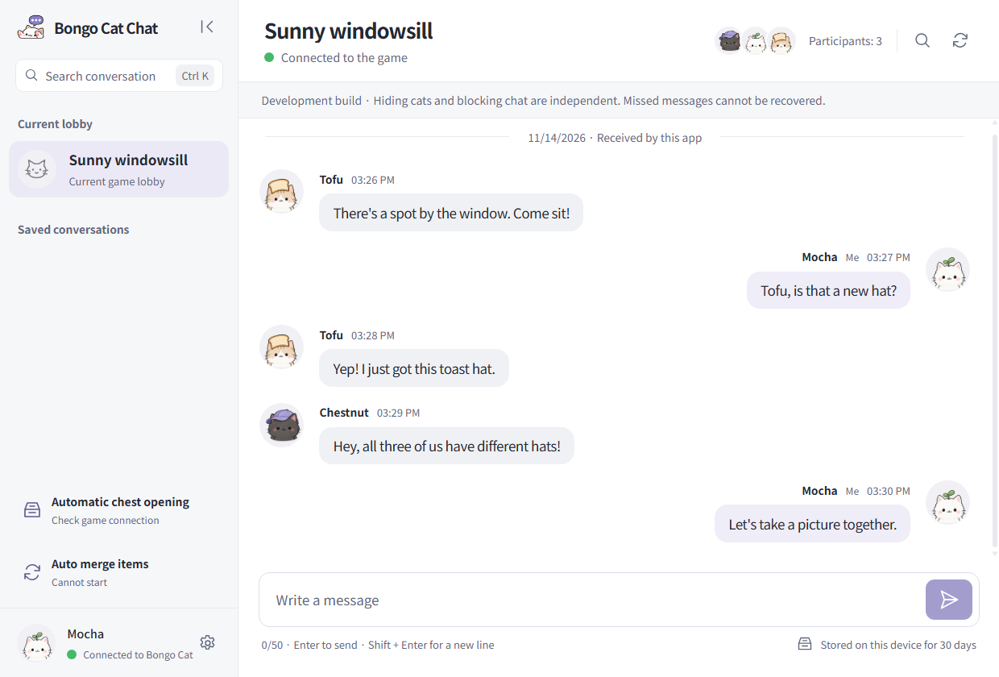
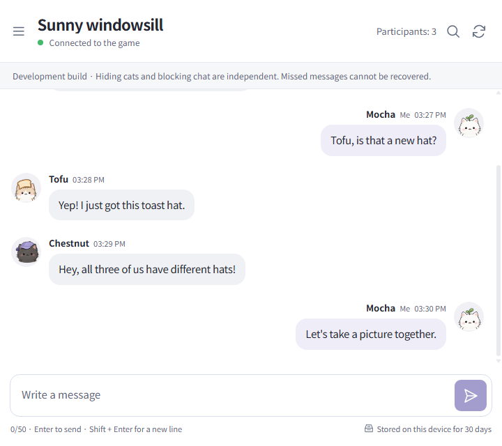
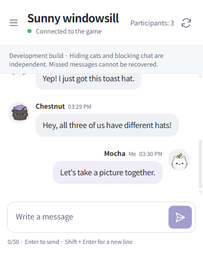

#  Bongo Cat Chat

[한국어](README.md) · English

**Bongo Cat Chat** is a Windows messenger for the Steam game Bongo Cat. Read and send lobby messages in a separate window while your friends keep chatting in the game as usual. The app keeps the messages it receives on your PC for 30 days, so you can search for something you missed.

- **Automatic chest opening** — Choose which chests to open and how long to wait before opening them. [Chest opening guide](docs/auto-chest.md#opening-chests)
- **Automatic item merging** — Choose an item group and a limit to merge duplicates one exchange at a time. [Item merging guide](docs/item-auto-merge.md#merging-items)

## Chat windows

The default window (1240 × 840) shows the lobby list beside the conversation and message box. All three sizes show the same sample conversation and fictional cat profiles in the app UI.

| Narrow window · 720 × 640 | Minimum window · 400 × 500 |
| --- | --- |
|  |  |

## Getting started

1. On Windows 10 or 11 (x64), open **Assets** on the [latest release](https://github.com/misosiruda/bongo-cat-chat/releases/latest). Download and run the installer whose name ends in `windows-x64-Setup.exe`.
2. Sign in to Steam, open **Bongo Cat**, and join a lobby in the game.
3. Open **Bongo Cat Chat** from the Start menu and check the lobby name. Press **Enter** to send a message or **Shift + Enter** to start a new line.

[Installation and updates](docs/releases/0.1.0.dev33.md#english) · [Release notes](https://github.com/misosiruda/bongo-cat-chat/releases) · [Report a problem](https://github.com/misosiruda/bongo-cat-chat/issues)

Bongo Cat Chat is an unofficial app by an independent developer. [Privacy policy](docs/privacy-policy.en.md) · [License](LICENSE)
