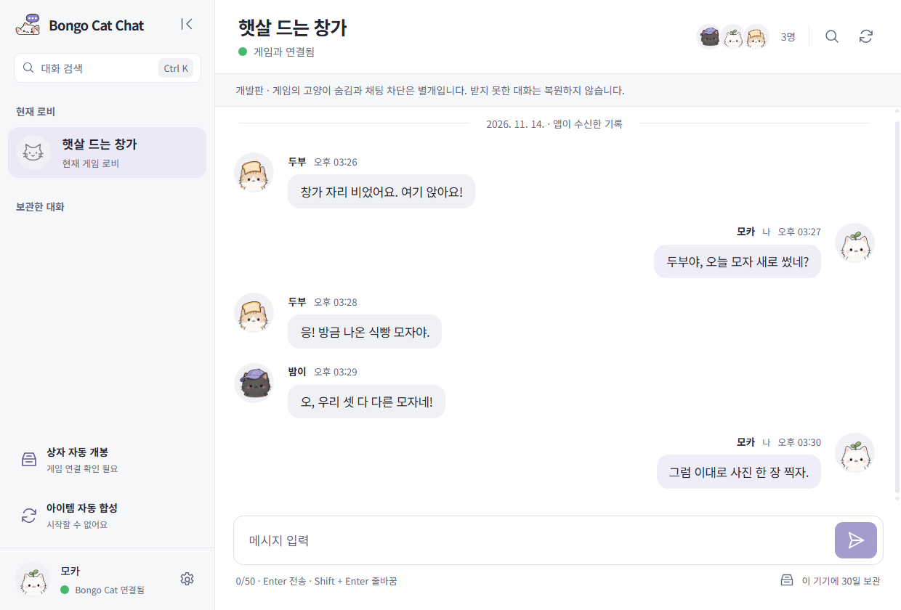
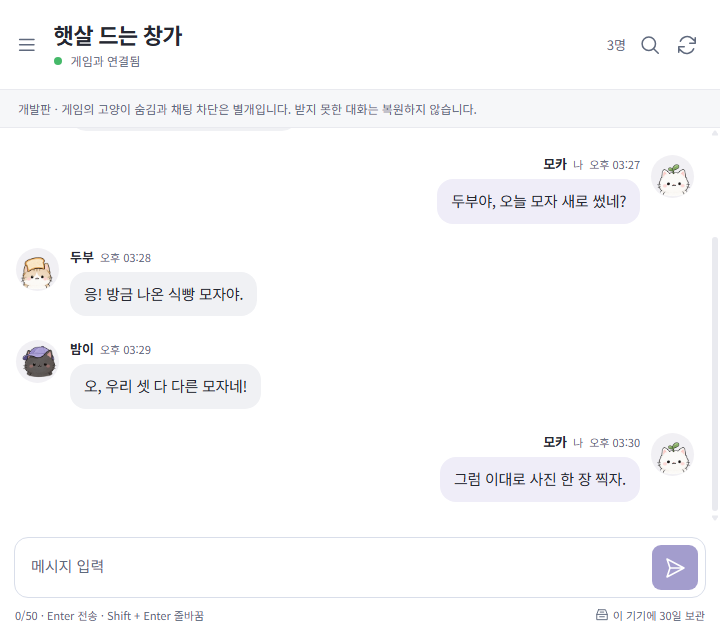
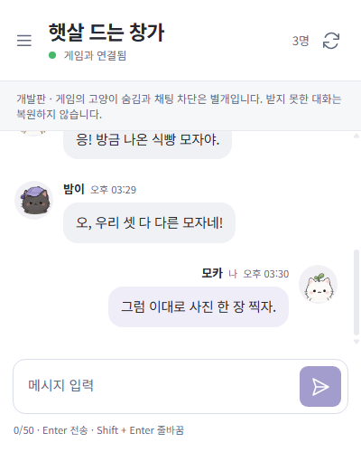

#  Bongo Cat Chat

한국어 · [English](README.en.md)

**Bongo Cat Chat**은 Steam 게임 봉고캣의 로비 채팅을 별도 창에서 읽고 보내는 Windows 메신저예요. 같은 로비의 친구는 게임에서 평소처럼 대화하면 돼요. 앱을 켜 둔 동안 받은 대화는 내 PC에 30일간 보관돼요. 놓친 메시지는 대화 검색에서 다시 찾아볼 수 있어요.

- **상자 자동 개봉** — 열고 싶은 상자와 대기 시간을 정하면 준비된 상자를 자동으로 열어요. [개봉 사용법](docs/auto-chest.md#사용-흐름)
- **아이템 자동 합성** — 아이템 그룹과 최대 횟수를 정하면 중복 아이템을 한 번씩 합성해요. [합성 사용법](docs/item-auto-merge.md#ui와-사용-흐름)

## 채팅 화면

기본 창(1240 × 840)에서는 왼쪽에 로비 목록을, 오른쪽에 대화와 입력창을 함께 볼 수 있어요. 아래 세 화면은 앱 UI에 같은 예시 대화와 가상의 고양이 프로필을 표시한 모습이에요.

| 좁은 창 · 720 × 640 | 최소 창 · 400 × 500 |
| --- | --- |
|  |  |

## 시작하기

1. Windows 10/11 x64에서 [최신 릴리스](https://github.com/misosiruda/bongo-cat-chat/releases/latest)의 **Assets**를 열고, 이름이 `windows-x64-Setup.exe`로 끝나는 설치 파일을 받아 실행해요.
2. Steam에 로그인하고 **Bongo Cat**을 켠 뒤 게임 안에서 로비에 참여해요.
3. 시작 메뉴에서 **Bongo Cat Chat**을 열고 로비 이름을 확인해요. **Enter**로 보내고 **Shift + Enter**로 줄을 바꿔요.

[설치·업데이트 안내](docs/installation.md) · [릴리스 노트](https://github.com/misosiruda/bongo-cat-chat/releases) · [문제 제보](https://github.com/misosiruda/bongo-cat-chat/issues)

Bongo Cat Chat은 독립 개발자가 만든 비공식 앱이에요. [개인정보 안내](docs/privacy-policy.md) · [라이선스](LICENSE)
