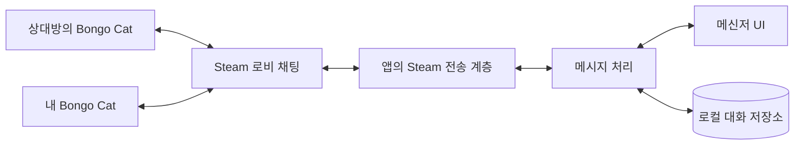
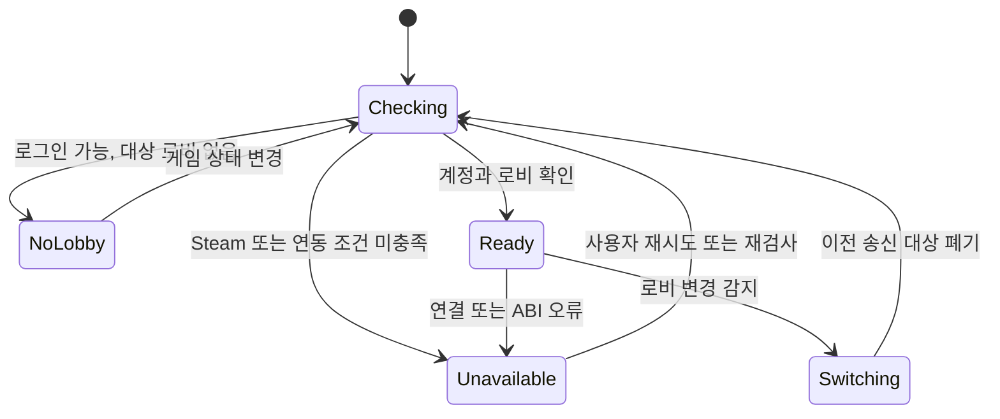
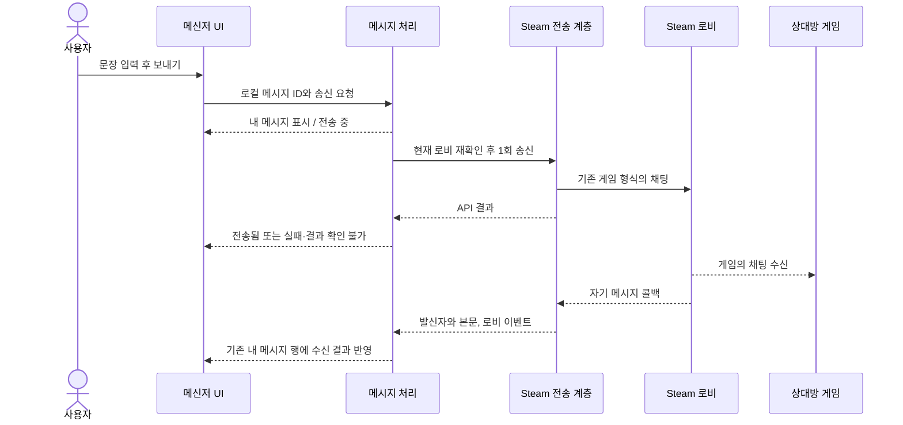

# 아키텍처 제안

상태: 2026-10-13 Windows 개발판 구현. 아래 내용은 설계 기준이며 실제 채택한 모듈·DB·지원 제한은 [Windows 개발판](windows-app.md), 실행 증거는 [제품 검증 기록](product-validation.md)에 둔다. 설계에 나온 모든 인수 조건이 완료된 것은 아니다.

## 1. 구성 원칙

프로그램은 현재 계정이 참여한 게임 로비의 채팅을 읽고 쓰는 별도 데스크톱 앱이다. 기존 게임 파일과 게임 프로세스는 변경하지 않는다. 메신저 UI와 대화 저장은 앱이 담당한다.



내 게임의 말풍선에는 연결하지 않는다. 상대방이 이 앱을 설치할 필요도 없다. 첫 제품의 통신에는 별도 메시지 서버를 추가하지 않는다.

## 2. 책임

| 구성 요소 | 책임 | 범위 밖 |
| --- | --- | --- |
| Steam 전송 계층 | API 초기화, 현재 계정·로비 확인, 콜백 처리, 송신 결과 반환 | 게임 패치, 게임 UI 조작, 임의 로비 가입 |
| 프로토콜 해석 | UTF-8 JSON 검증, 채팅 채널 분류, 형식·길이 검사 | 게임 보상·탭·아이템 메시지의 실행 또는 변조 |
| 메시지 처리 | 내 메시지 상태, 자기 수신 중복 조정, 로비 경계, 저장 요청 | 상대방 열람 여부 추정 |
| 표시·보관 정책 | 확인된 숨김 상태와 설정에 따라 목록·알림·저장 여부 결정 | 미확인 게임 설정을 동기화 완료로 취급 |
| 로컬 저장 | 수신한 기록의 보관, 조회, 검색, 삭제·내보내기 | 수신하지 않은 과거 대화 생성 |
| 메신저 UI | 메시지 목록, 한글 입력, 연결·송신·저장 상태 표시 | 게임 내부 말풍선 표시 |

개발판은 Python `multiprocessing` 작업자로 네이티브 호출을 격리하고 상속된 크기 제한 큐로 통신한다. Qt WebEngine과 QWebChannel을 사용하는 UI 프로세스에서 SQLite를 단일 스레드로 소유한다. 제품은 HTTP 서버나 네트워크 수신 포트를 열지 않는다. 구현 모듈은 `environment/memory/steam/worker` → `service/store` → `desktop/ui`다.

## 3. 초기화와 종료

### 초기화

1. Steam과 게임 설치 경로, 파일 존재, 프로세스 아키텍처를 확인한다.
2. 검증된 경로의 Steam 라이브러리를 로드한다. 임의 작업 폴더의 동명 DLL을 우선 로드하지 않는다.
3. 앱이 사용하는 프로세스 범위에서 게임 App ID를 설정하고 초기화한다.
4. 지원하는 인터페이스와 구조체 크기를 검사한다. 알 수 없는 ABI를 추측해 호출하지 않는다.
5. 현재 계정과 현재 게임 로비를 읽고 송신 가능 상태를 결정한다.

PoC는 설치 DLL에서 가장 높은 버전의 내보낸 인터페이스를 선택했다. 제품에서는 확인한 인터페이스 계약을 명시하고, 미지원 버전은 진단 결과를 보여 주는 방식으로 보강한다.

### 종료

- 사용 중인 콜백 데이터를 해제하고 앱의 Steam 연결을 정리한다.
- 메시지 저장 작업의 완료 또는 실패를 사용자에게 설명할 수 있어야 한다.
- 앱이 생성하지 않은 게임 로비를 나가거나 게임 프로세스를 종료하지 않는다.
- `LeaveLobby`, 방 생성, 로비 설정 변경은 기존 PoC의 격리 시험용 동작이며 제품 기본 동작이 아니다.

종료가 게임의 연결 상태에 영향을 주지 않는지는 여러 실행 순서와 장시간 시험으로 추가 검증한다.

## 4. 연결 상태



로비가 바뀌는 동안 입력 초안은 보존할 수 있지만, 이전 로비에 예약된 메시지를 새 로비로 자동 송신하지 않는다. 대상 변경을 UI에 표시하고 사용자가 현재 로비에서 보내도록 한다. 구체적인 재검사 주기와 자동 복구 정책은 시험 후 결정한다.

계정·로비·연결 구간을 송신 요청과 수신 작업에 함께 기록한다. 방이 바뀌면 새 연결 구간으로 전환하고 이전 구간의 늦은 메시지·프로필 조회 결과가 새 화면을 갱신하지 않게 한다. 초안은 작성한 방에 귀속한다. 상태 재조회만 하는 수동 새로고침도 제공할 수 있다.

이벤트와 주기적 조회를 조합하는 안을 검토하되, 같은 계정의 별도 프로세스에 게임의 모든 로비 변경 이벤트가 전달된다고 가정하지 않는다. 마지막 로비 확인과 송신 API 호출은 게임의 로비 변경에 대해 원자적이지 않다. 이미 호출한 요청의 대상을 바꾸거나 새 방으로 다시 보내지 않는다. [전환 시나리오](edge-cases.md)

## 5. 수신 처리

1. 앱이 소유한 Steam 콜백 큐를 처리한다.
2. 이벤트 종류와 구조체 크기를 검사한다.
3. 현재 수신 세션과 로비에 속한 이벤트인지 확인한다.
4. 콜백이 유효한 동안 `GetLobbyChatEntry`를 호출해 실제 반환 길이만큼 본문을 앱이 소유한 버퍼에 복사한다.
5. 길이·발신자·메시지 유형을 확인하고 UTF-8과 JSON을 해석한다.
6. 객체의 `Channel`이 `3`이고 `Message`가 문자열인 경우에만 채팅으로 처리한다.
7. 본문 검증 후 확인된 언어별 클릭 울음 문구와 전체가 일치하면 이벤트를 만들지 않는다. 필터링한 정상 패킷은 파싱 실패 건수에 포함하지 않는다.
8. 자체 수신 ID를 부여하고 자기 메시지 대응 및 확인된 표시·보관 정책을 적용한 뒤 저장·UI 갱신 작업을 전달한다.
9. 성공·실패와 무관하게 콜백 버퍼를 해제한다.

울음 판정은 `protocol.is_meow_message` 하나를 수신 파서·서비스·기록 조회에서 사용한다. SQLite 연결에 동일 함수를 등록하고 페이지 `LIMIT` 이전에 제외해 울음 기록만 가득한 페이지가 일반 대화 탐색을 끊지 않도록 한다. 기존 행은 삭제하지 않으며 검색과 미저장 화면에도 적용한다. 기준은 설치 빌드 `25902419`의 27개 언어·대소문자 통합 후 18개 문구다. 본문 전체를 NFC 정규화하고 앞뒤 공백·대소문자만 무시하며 부분 일치는 허용하지 않는다. 자동/직접 입력의 출처는 게임 패킷으로 구별할 수 없다. [D-022](decisions.md#d-022-고양이-클릭-울음을-대화에서-제외한다)

PoC에서 다른 이벤트와 탭 관련 메시지가 채팅보다 훨씬 많았다. 채팅으로 분류하지 않은 원본을 대화 데이터베이스에 쌓지 않는다. 잘못된 JSON이나 알 수 없는 채널을 받은 경우 앱을 종료하거나 내용을 실행하지 않고, 본문 없는 진단 카운터로 남기는 방향을 제안한다.

`m_iChatID`는 현재 콜백에서 본문을 조회하는 데만 사용한다. 콜백 포인터나 이 번호를 작업 큐·DB에 넘겨 나중에 조회하지 않는다. 공식 문서는 콜백 범위 밖에서 유효하지 않고 저장하면 안 된다고 명시한다. [Steam 콜백 문서](https://partner.steamgames.com/doc/api/ISteamMatchmaking#LobbyChatMsg_t)

### 게임의 숨김·필터와 앱 정책

게임의 개별 숨김은 내부 캐시와 게임 오브젝트 표시로 처리된다. 2026-10-13 별도 실험에서 게임 메모리를 읽어 현재 캐시 조회와 같은 이용자의 숨김·해제 감지를 확인했지만, Steam 전송 계층이 자동으로 제공하는 값은 아니다. 이 실험 어댑터의 제품 채택·호환성과 앱 전체 필터 적용 검증은 남아 있다. Bongo Cat의 상태를 읽어 자동 반영하는 것은 필수 요구사항이다. 앱의 독립적인 숨김 설정·수동 목록은 두지 않으며, 확인한 게임 상태를 계정 식별자 기준으로 기존·새 대화, 검색·미리보기·알림·읽지 않은 수에 동일하게 적용한다.

숨김 상태는 확인됨·오래됨·확인 불가로 구분한다. 개발판은 숨김 중 새 상대 메시지를 저장하지 않고 기존 기록은 화면·검색에서 제외한다. 2.5초 이상 갱신되지 않거나 조회 실패·사용자 미확인 상태면 상대 노출·신규 저장과 송신을 차단한다. 게임의 전체 채팅 끄기·자동 고양이 숨김·언어 필터는 별도 미결 정책이다. [설정별 검토](edge-cases.md)

### 프로필·숨김 조회의 기술 후보

- 이름: `GetPlayerNickname`을 우선하고 없으면 `GetFriendPersonaName`을 사용한다. 게임에서 확인한 선택 규칙이다.
- 외형: `hat`·`skin` 로비 멤버 데이터와 아이템 정의를 연결한다. 정지 고양이 이미지는 설치 리소스의 스킨·모자를 읽어 구성하는 경로를 실험했다.
- 숨김: 현재 빌드의 정적 캐시를 읽는 별도 어댑터 후보가 있다. 게임 재시작·버전 변경 시 주소와 구조를 재검증하고 실패를 빈 숨김 목록으로 변환하지 않는다.

각 조회 결과에는 계정·로비·프로세스·관찰 시각을 연결하는 설계가 필요하다. 이번 실험은 현재 세션의 읽기 확인이며 로비 전환 안전성을 입증하지 않는다. [실행 검증과 제한](profile-sync-validation.md)

## 6. 송신과 내 메시지 표시



수신 콜백과 API 결과가 도착하는 순서는 고정돼 있다고 가정하지 않는다. 두 결과가 어느 순서로 와도 내 메시지 행은 하나여야 한다.

### 전송 상태의 의미

| 내부 상태 제안 | 의미 | UI에서 피할 표현 |
| --- | --- | --- |
| `pending` | 앱이 송신을 요청했고 결과 대기 중 | 상대방에게 전달 완료 |
| `accepted` | Steam 송신 API가 성공을 반환함 | 읽음, 상대 화면 표시 완료 |
| `echo_observed` | 같은 계정의 해당 채팅 수신 이벤트를 관찰함 | 상대방 확인 완료 |
| `failed` | 전송 전 검증 실패 또는 명시적인 API 실패 | 성공 |
| `unknown` | 프로세스 종료·시간 초과 등으로 결과를 확정할 수 없음 | 미전송 확정 |

`echo_observed`는 진단용 보조 상태로 둘 수 있다. 일반 사용자에게 필요하지 않은 내부 용어를 노출하지 않는다. 결과 불명 상태에서 자동 재전송하면 상대방에게 같은 문장이 여러 번 나타날 수 있으므로 자동 재시도를 기본 동작으로 두지 않는다.

### 중복 조정

기존 게임의 채팅 형식에는 앱이 부여한 메시지 UUID가 없다. 앱의 로컬 ID를 본문에 붙이거나 게임 프로토콜에 새 필드를 추가하지 않는다.

- 수신 본문을 복사할 때 앱 자체 ID를 한 번 부여한다. 같은 내부 처리의 저장·UI 재시도는 이 ID를 재사용해 중복 반영을 막는다.
- Steam의 콜백 한정 채팅 번호를 저장하거나 영구 중복 제거 키로 사용하지 않는다. 서로 다른 외부 콜백이 같은 발언인지 완벽하게 식별할 수 있다고 가정하지 않는다.
- 자기 수신과 송신 대기 행의 대응은 동일 계정·동일 로비·정확히 같은 본문·제한된 시간 범위와 송신 순서를 사용한다.
- 동일한 문장을 연속 두 번 보냈다면 두 메시지를 유지한다. 본문 해시만으로 전체 대화를 중복 제거하지 않는다.
- 대응이 모호하거나 게임 입력창과 앱에서 같은 문장을 동시에 보내면 잘못 합치지 않도록 처리한다. 이 경우의 정책과 테스트가 선행돼야 한다.
- 본문이 같다는 이유만으로 재접속 전후 메시지를 합치지 않는다. 대화의 정확한 재전달 식별·복구는 미검증이다.

## 7. 전송 형식과 제한

관찰한 채팅 데이터는 UTF-8로 인코딩한 다음 형태다.

```json
{"Channel":3,"Message":"메시지 본문"}
```

전송 길이는 문자열 길이가 아니라 JSON 전체의 인코딩된 바이트 길이로 계산한다. 한글, 따옴표, 역슬래시는 바이트 길이 또는 JSON 이스케이프 길이에 영향을 준다.

원본 PoC는 문장을 최대 50 Python 문자로 제한했다. 개발판은 50 UTF-16 단위·전체 JSON 4,096바이트 상한을 사용하며 게임의 공식 입력 한도로 확인한 값은 아니다. 실제 게임 제한과 이모지·특수문자의 화면 호환성은 별도 인수 기준이다.

## 8. 로컬 데이터 모델 제안

SQLite를 채택했다. 아래 표는 개념 모델이며 실제 스키마 버전 1은 `src/bongo_chat/store.py`에 있다. `sessions/messages/receipts/drafts/settings`를 사용하고 앱 UUID와 별도 정수 수신 순번을 둔다. 기존 스키마가 없는 개발판용 생성이며 알 수 없는 버전은 열지 않는다. 자동 내보내기·백업은 없다.

| 데이터 | 주요 필드 제안 | 주의사항 |
| --- | --- | --- |
| 로비 기록 | 내부 ID, Steam 로비 ID, 관찰한 이름, 최초·최종 관찰 시각 | 이름 변경과 로비 재생성을 같은 방으로 단정하지 않음 |
| 수신 세션 | 내부 세션 ID, 현재 계정, 로비, 시작·종료 시각, 종료 사유 | 누락 가능한 구간과 세션 경계를 남김 |
| 메시지 | 로컬 ID, 세션, 로비, 발신자 ID, 표시 이름 스냅샷, 본문, 방향, 순번, 수신 시각 | 본문을 실행 가능한 HTML로 취급하지 않음 |
| 송신 상태 | 로컬 메시지 ID, 요청 시각, API 결과, 자기 수신 여부, 오류 코드 | 상대방 열람 정보로 해석하지 않음 |

Steam 식별자는 JSON·JavaScript의 숫자 정밀도 문제를 피하도록 문자열로 전달·보관하는 안을 사용한다. 수신 순번과 UTC 수신 시각을 함께 두며, 시계 변경으로 순서가 뒤집히는 문제를 검토한다.

저장 실패는 수신 실패와 다르다. 디스크 공간 부족 등으로 메시지를 저장하지 못했을 때 사용자가 기록이 안전하게 보관됐다고 오해하지 않도록 알린다. 보관 기간·암호화·내보내기 형식·삭제 방식은 [개인정보 검토](distribution-and-privacy.md)에서 추가 결정한다.

## 9. 구현 기술 선택

현재 Python은 통신 가능성을 확인한 PoC 언어다. 이것이 제품 UI와 배포 런타임의 확정을 뜻하지 않는다.

| 검토 대상 | 확인할 내용 |
| --- | --- |
| Windows 데스크톱 기술 | Steam FFI 연동, 한글 입력, 트레이·알림, 패키징과 설치 경로 |
| 웹 기반 데스크톱 셸 | 메신저 화면 구현, 네이티브 통신 계층 격리, 로컬 IPC 권한과 업데이트 |
| Python 전송 프로세스 유지 | 배포 크기, 실행 환경 포함 방식, 프로세스 수명주기와 오류 전달 |

어느 안의 성능·메모리 사용량·배포 편의성도 측정하지 않았다. UI 프레임워크를 먼저 확정하기보다 순정 환경과 연결 수명주기 검증 후 한 가지 조합을 선택한다.

## 10. 장애와 관측

| 상황 | 제품 동작 제안 |
| --- | --- |
| Steam 미실행·로그아웃 | 연결 불가 표시, 송신 비활성화 |
| 게임 또는 대상 로비 없음 | 저장된 기록만 조회, 송신 비활성화 |
| 로비 이동 | 이전 송신 대상 폐기, 초안 보존 여부 안내 |
| 숨김 상태 미확인·오래됨 | 동기화 여부를 표시하고 확정할 표시·저장 정책에 따름. 게임 설정을 읽었다고 가정하지 않음 |
| 미지원 DLL·ABI | 호출 중단, 확인된 버전과 오류만 진단에 기록 |
| 콜백 파싱 실패 | 해당 이벤트 제외, 본문 없이 실패 건수 기록 |
| 전송 중 연결 끊김 | 결과 불명 표시, 자동 재전송 금지 |
| 로컬 저장 실패 | UI 표시와 저장 상태를 구분해 안내 |
| 앱 다중 실행 | 중복 송신·저장 방지 정책 필요. 단일 인스턴스 우선 검토 |

진단 로그에는 기본적으로 채팅 본문·전체 사용자 ID·입장 코드를 넣지 않는다. 로깅, 재연결, 저장, UI의 전체 흐름은 [검증 계획](roadmap.md)의 실제 시험을 통과해야 한다.
